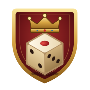

# 亨利广场 · Henry Square（v3.1）

一个中世纪酒馆风格的 3D 掷骰小游戏（Farkle 规则 + 特殊骰子）。所有，或者一无所有。

**在线试玩：<https://tenshojin.github.io/henry-square/>**（建议用电脑上的 Chrome 或 Edge 打开）

## 怎么玩

1. 打开上面的在线试玩网址；或者下载 **`亨利广场.html`** 后双击，用 Chrome 或 Edge 打开（离线也能玩，所有资源都打包在这一个文件里）。
2. 点「推门而入」→ 观看开场动画（右下角可跳过）→ 在画面下方挑选对手（点一个，原来的对手起身离开，新的人走过来坐下）→「入座开局」。
3. 「命运之骰」：你的 6 枚骰子每枚有 50% 几率被提供一枚特殊骰子，逐枚决定换或不换，确定后本局不再变化。
4. 对局中：
   - 点「掷骰」（或按 **空格**）：骰子一颗颗落进骰盅（进盅时缩小，在盅里有更大的翻滚空间），摇几下后倒进骰盘，出盅时再平滑地变回原来大小。
   - 点击盘里的骰子挑出计分组合（金色光圈 = 已选）。
   - 「留下并再掷」（空格）继续用剩下的骰子掷；「收分过手」（**回车**）把本回合分数存入总分。
   - 鼠标移到自己的骰子上可以看到名字和脾气；对手的骰子只能看到点数——它换没换骰子，得靠你自己观察。
5. 左下角工具栏：菜单、计分规则、骰子图鉴、中/英切换、音乐、音效。

## 难度

| 难度 | 对手 | 目标分 |
|---|---|---|
| 休闲 | 女店员（设定图角色 4） | 750 |
| 新手 | 喝酒的中年游侠（角色 2） | 1500 |
| 酒馆常客 | 白胡子老人（角色 3） | 3000 |
| 斯卡利茨骰子王 | 掷骰子的年轻人（角色 1） | 8000 |

不上场的人各回各位：中年人坐桌子左边、老人坐右边、年轻人坐后面那张桌喝酒，女店员端着托盘来回送酒。

游戏里不会告诉你对手换了哪些骰子。设计上：休闲不换、新手最多换 1 枚、常客换 2–3 枚、骰子王换 4–6 枚并优先挑好骰子；难度越高，AI 的留骰与收分策略也越精明。

## 计分

单个 1 = 100，单个 5 = 50；三个 1 = 1000，三个 2–6 = 点数 × 100；四/五/六个相同 = 三个的分数 × 2/4/8；
小顺 1-5 = 500，大顺 2-6 = 750，全顺 1-6 = 1500。
魔鬼骰子的恶魔面是万能面，但必须与至少两枚其他骰子一起组成得分组合；天国骰子的神圣 6 面只能当 6。

## 修改与重新打包

- 源代码在 `src/`：
  - `src/data/dice.js` 骰子数据（概率、提示文字、外观）
  - `src/game/` 计分规则、AI、游戏流程
  - `src/render/` 3D：`world.js` 载入 Blender 烘焙好的酒馆、还原光照贴图、给动态物体打光、放火焰和骰盘；`people.js` 四个人物：谁坐对面，起身推椅子 / 走路 / 转身坐下挪椅子的状态机，动作按权重交叉淡化，表情、视线、握骰盅和放托盘的 IK；`assets.js` 读取内嵌的模型；骰子模型、骰盅、物理、钱币
  - `assets/models/`：Blender 导出的 `tavern.glb`（整间酒馆 + 烘焙光照）、四个人物的 GLB（`people.json` 是走路速度等参数）、会动的道具 `props.glb`（椅子、酒杯、托盘）、桌边全景光照 `probe.hdr`（由下面的 Blender 脚本生成）
  - `src/audio/` 声音；`src/ui/` 界面、样式和游戏图标（`icon.js`）；`src/i18n.js` 中英文文本
- 网页版：仓库根目录的 `index.html` 只负责跳转到 `亨利广场.html`，`.nojekyll` 让 GitHub Pages 原样发布文件。推送到 main 分支后，在线版一两分钟内自动更新。
- 改完后双击 **`rebuild.bat`**（或运行 `tools\node\node.exe build.mjs`），会重新生成 `亨利广场.html`。
  - 骰子外观有改动时，打包脚本会自动用电脑上的 Chrome/Edge 在后台重新生成骰子缩略图。
  - 中文标题字体（思源宋体）只打包游戏里用到的字；新增文字后重新打包即可。
- 从 GitHub 下载代码后：仓库里没有放体积大的本地工具，需要先补齐——
  1. 把便携版 Node.js 放到 `tools/node/`（或者安装 Node.js 后直接运行 `node build.mjs`）；
  2. 在项目文件夹里运行 `npm install`，装回 `node_modules`；
  3. 可选：下载 Noto Serif SC 字体（Google Fonts，SIL OFL 授权），存为 `tools/fonts/NotoSerifSC-VF.ttf`。没有它也能打包，只是中文标题会改用系统字体。
- Blender 建模（`tools/blender/`，需要 Blender 5.2 + MPFB 扩展 + MakeHuman 素材包）：
  - `build_characters.py`：用 MPFB 生成四个人物（身体、皮肤、眼睛、头发、胡子、表情形态键，站姿）→ 按设定图做衣服（`chars_outfits.py`）→ 按设定图三视图的轮廓把身体和衣服横向拉宽/收窄，再把三视图投影烘成衣服贴图（`chars_project.py`；三视图的去背景图在 `C:\blender\henry_square\reference\views`）→ 动作（`chars_motion.py`：站、走、坐、坐下、起身、笑、喝、端托盘）→ 导出 GLB；文件存到 `C:\blender\henry_square\characters.blend`
  - `export_props.py`：椅子（按设定图的竖条靠背木椅）、木酒杯、锡酒杯、托盘，把程序材质的颜色烘成贴图后导出 `props.glb`
  - `build_tavern.py`：搭整间酒馆（石墙、木梁、柜台酒架、壁炉、圆拱窗、旗帜、吊灯、道具）→ `tavern.blend`；`paint_textures.mjs` 画旗帜、盾牌、黑板、地毯、招牌的图案
  - `bake_tavern.py`：后台运行 `blender -b tavern.blend --python bake_tavern.py`，用 Cycles 把光照烘进每组物体的贴图，导出 `tavern.glb`
  - 导出后把 `C:\blender\henry_square\export` 里的文件拷到 `assets/models/` 再重新打包
- 自测脚本：`tools/test_logic.mjs`（计分与 AI）、`tools/test_cup.mjs`（骰盅物理：成功率、耗时、摇盅时骰子有没有飞出盅口、盅里的骰子有没有缩小）、`tools/shot.mjs`（无头浏览器按步骤截图）。
- 图标：`tools/make_icon.mjs` 由 `src/ui/icon.js` 生成 `assets/icon.svg` 和 PNG。
- 观众英语语音由 `tools/gen_voices.ps1` 用 Windows 自带语音离线生成，放在 `assets/voices/`。

## 更新记录

- **v3.1**：不同难度换成不同的对手（休闲 = 女店员、新手 = 中年游侠、酒馆常客 = 白胡子老人、骰子王 = 掷骰子的年轻人）。选对手时，原来的人把椅子往后一推、起身走回自己的位置，新的人走过来、转身坐下、再把椅子挪近桌子；女店员上场前先把托盘放到柜台上，下场后再端起来继续送酒。人物改成站姿建模，新增走路（步频和速度对上、不打滑，起步、减速、转弯都平滑）、坐下、起身、手放腿上等动作，喝酒时手握住杯子。四个人的衣服按新设定图重做（铆钉皮马甲和斜挂的工具腰带、带兜帽的皮披肩和开衩长皮外套、橄榄绿毛边短斗篷和米色围裙、深绿胸衣长裙和背后的蝴蝶结），再按三视图轮廓修正体形，并把设定图三视图直接投影成衣服贴图，颜色和细节取自原图；椅子按设定图改成竖条靠背。菜单改成贴在画面下方的一条，上方能看到对面的座位；开场动画停在对手面前，开局时镜头平滑移到牌桌上。加了椅子拖动声和脚步声。

- **v3.0**：整个酒馆和人物改用 Blender 重新建模。场景按参考图搭建（不规则毛石墙、粗木梁和立柱、圆拱铅格窗、狮子纹章旗与盾牌、挂鹿头和吊锅的石砌壁炉、摆满酒瓶陶罐的柜台酒架、横放的大酒桶、铁艺烛台吊灯、红地毯、门外的街道和招牌，还有柜台边睡觉的猫），用 Cycles 把全局光照、阴影和环境光遮蔽烘焙进贴图，网页里看到的就是接近离线渲染的光影；四个人物用 MPFB（MakeHuman）生成写实的身体和脸，按设定图做衣服（卷袖衬衫配皮马甲、长皮大衣、兜帽斗篷和布帽、紧身胸衣配围裙长裙），带骨骼动画和表情（眨眼、微笑、大笑）；道具按设定图重做（木酒杯、锡酒杯、带龙头的酒桶、搁板桌、梯背椅、烤鸡面包奶酪拼盘、骰袋、碟形烛台、藤编酒瓶）；动作改为交叉淡入淡出：喝酒、大笑、女店员端着托盘来回走，对面的年轻人俯身握住骰盅，视线和表情都平滑过渡；界面改为烛光下的烟色玻璃面板 + 双金线描边 + 哥特花饰角，按钮是金边酒红丝绒，横幅是从中间向两边展开的金线；加载更快。
- **v2.0**：新图标（酒红盾牌、金王冠、象牙骰子），用作网页标签图标和开场/菜单徽记；参照概念图把酒馆整个重建——石墙木梁、圆拱彩格玻璃窗、狮子纹章旗和盾牌、带鹿头和吊锅的石砌壁炉、摆满酒瓶陶罐的柜台和酒架、铁艺烛台吊灯、地毯和兽皮，石墙/木板/铁件改用程序生成的高精度材质，加入环境光遮蔽和柔和泛光；按设定图重做全部人物（骨骼蒙皮、可眨眼和微笑的脸、头发胡子、多层衣服）：对面卷袖马甲的年轻掷骰手（会伸手握住骰盅、看骰子、大笑）、左边长发大胡子穿皮大衣喝酒的中年人、右边白胡子戴布帽的老人、端着托盘在酒馆里来回走的女店员，还有柜台边的猫和其他客人；按设定图重做木杯、锡杯、酒桶、长桌、靠背椅、烤鸡面包奶酪拼盘、骰袋、烛台、藤编酒瓶；玩家的骰子变换概率改为 50%，骰子王目标分改为 8000；骰子进骰盅时缩小、出盅时平滑变回原大，盅里翻滚空间更大；界面重新设计为橡木框、深色皮革、黄铜包边和熟铁角件，按钮悬停有一道烛光扫过，当前回合的面板换成黄铜框并有呼吸光，横幅改为挂在铁杆上展开的纹章旗，开场有缓缓上飘的火星。
- **v1.2**：开场标语改为「所有，或者一无所有」；酒馆按中世纪小酒馆重新布局（后墙中央大壁炉，左边柜台、酒桶架和上二楼的楼梯，右边圆片玻璃窗下的掷骰桌，临街大门外是傍晚的街道），桌凳、酒桶、酒杯、烛台、吊灯、烤肉架、鹿角、楼梯、木板门等场景模型全部重做；加入 12 位平民客人：掷骰的、喝酒聊天的、端托盘的女招待、擦酒杯的掌柜、柜台前聊天的妇人、烤火的老人、趴在桌上睡着的醉汉、坐在酒桶上弹鲁特琴的乐手，还有坐在你对面的兜帽陌生人；开场改为站在门外推门而入（门外的声音闷、进门后变清楚），镜头沿平滑轨迹从客人身边走到桌前（整条轨迹最大转动速度约每秒 15°，结尾缓缓停稳）；掷骰改为骰子落进敞口骰盅、在盅里真实翻滚碰撞、再倒进骰盘；金币和银币按格罗申的样式重做（王冠正面、狮子背面、边缘铭文、手工打制的不规则边缘），桌上加了钱币堆和皮钱袋。
- **v1.1**：游戏改名「亨利广场」；酒馆改为傍晚斜阳透过圆片玻璃窗的明亮场景（石板地面、石灰白墙、壁灯、梁上挂的火腿大蒜、铁锅、陶罐、麻袋）；界面重做为毛边羊皮纸、卷轴、木牌按钮、丝带横幅和火漆印章，中文标题改用宋体、英文改用哥特体；修复图鉴滚动时边框错位；不再透露对手是否换骰子；新增得分飘字、悬停光圈、键位提示、全骰得分的掌声、胜利时的金币雨；加载时间从约 18 秒缩短到约 4 秒。
- **v1.0**：首个版本。
