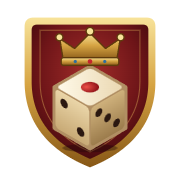

# 亨利酒馆 · Henry's Tavern（v4.1）

一个中世纪酒馆风格的 3D 掷骰小游戏（Farkle 规则 + 特殊骰子）。所有，或者一无所有。

**在线试玩：<https://tenshojin.github.io/henry-square/>**（建议用电脑上的 Chrome 或 Edge 打开；网址沿用改名前的 henry-square）

## 怎么玩

1. 打开上面的在线试玩网址；或者下载 **`亨利酒馆.html`** 后双击，用 Chrome 或 Edge 打开（离线也能玩，所有资源都打包在这一个文件里；`亨利广场.html` 是改名前的文件名，现在只负责跳转）。
2. 点「推门而入」→ 开场动画：推开酒馆的门、走进去、停在老人对面（右下角可跳过）→ 在画面下方挑选对手（点一个，原来的人起身离开，新的人走过来坐下）→「入座开局」：镜头低头看向牌桌，换成实时渲染的牌桌开始对局；回菜单时镜头再从牌桌抬头看向对面。
3. 「命运之骰」：你的 6 枚骰子每枚有 50% 几率被提供一枚特殊骰子。可更换的骰子有金色描边、星纹和「可替换」标记，逐枚决定换或不换，确定后本局不再变化。
4. 掷币定先手：一枚金币从你面前弹起、翻转着落进骰盘，**正面你先手，反面对手先手**。镜头推近展示币面，金币随后轻抬、平移并放到左侧桌边的中立位置，与骰子留出明显空隙，落点不随先手归属改变。结果只显示正反面与先手情况，点「开始对局」后继续。计分牌的小币提醒谁先手。金、银、铜钱堆高低错落，散币围在旁边。
5. 对局中：
   - 点「掷骰」（或按 **空格**）：骰子一颗颗落进骰盅（进盅时缩小，在盅里有更大的翻滚空间），摇几下后倒进骰盘，出盅时再平滑地变回原来大小。
   - 点击盘里的骰子或下方的点数按钮挑出计分组合（金色光圈 = 已选），也可以用数字键 **1–6** 选择对应骰子。选骰区显示当前骰子的名称和缩略图，鼠标悬停下方按钮也可以查看。
   - 「留下并再掷」（空格）继续用剩下的骰子掷；**按住「长按收分过手」约 0.9 秒**，金色进度填满后把本回合分数存入总分。提前松开、移出按钮或切走页面会取消；**长按回车**也可确认，聚焦收分按钮时长按空格同样有效。
   - 鼠标移到自己的骰子上可以看到名字和脾气；对手的骰子只能看到点数——它换没换骰子，得靠你自己观察。
6. 赢了以后桌上会撒下一大片金色格罗申，难度越高越多（休闲 90 枚、新手 160、常客 260、骰子王 420）。双方爆骰导致本回合 0 分时，暗红火漆印记落下，显示「0 分」并播放叹气声；单次掷出的最佳组合达到 1000 分时，烛金数字、细碎金屑和花纹浮现，配合欢呼声。提示停留约 2.2 秒后淡出；「本次掷骰最高可得」不等于已经收分。遵循系统的减少动态效果偏好。
7. 工具栏：菜单、计分规则、骰子图鉴、牌局记录、中/英切换、音乐、音效。打开规则或图鉴时暂停对局，按 Esc 合上；手机工具栏在底部。

## 难度

| 难度 | 对手 | 目标分 |
|---|---|---|
| 休闲 | 女店员（设定图角色 4） | 750 |
| 新手 | 喝酒的中年游侠（角色 2） | 1500 |
| 酒馆常客 | 白胡子老人（角色 3） | 3000 |
| 斯卡利茨骰子王 | 掷骰子的年轻人（角色 1） | 8000 |

游戏里不会告诉你对手换了哪些骰子。设计上：休闲不换、新手最多换 1 枚、常客换 2–3 枚、骰子王换 4–6 枚并优先挑好骰子；难度越高，AI 的留骰与收分策略也越精明。

## 计分

单个 1 = 100，单个 5 = 50；三个 1 = 1000，三个 2–6 = 点数 × 100；四/五/六个相同 = 三个的分数 × 2/4/8；
小顺 1-5 = 500，大顺 2-6 = 750，全顺 1-6 = 1500。
魔鬼骰子的恶魔面是万能面，但必须与至少两枚其他骰子一起组成得分组合；天国骰子的神圣 6 面只能当 6。

## 修改与重新打包

- 源代码在 `src/`：
  - `src/data/dice.js` 骰子数据（概率、提示文字、外观）
  - `src/game/` 计分规则、AI、游戏流程
  - `src/render/` 3D 和过场动画：`world.js` 载入 Blender 烘焙好的酒馆、还原光照贴图、给动态物体打光、放火焰和骰盘；`cutscenes.js` 播放过场动画（两个 `<video>` 轮流播、接缝处交叉淡化，和实时的牌桌画面互相切换，人物起身 / 走路的声音）；`assets.js` 读取内嵌的模型和视频；`groschen.js` 格罗申（币面、凸边、锤打的币边、银的材质）、`coinToss.js` 开局掷币、`coinShower.js` 胜利撒钱；骰子模型、骰盅、物理
  - `assets/models/`：Blender 导出的 `tavern.glb`（整间酒馆 + 烘焙光照；实时画面只用到牌桌这一块）、道具 `props.glb`（桌角的锡酒杯）、桌边全景光照 `probe.hdr`（由下面的 Blender 脚本生成）
  - `assets/cutscenes/`：过场动画（AV1 视频，1280×640、每秒 32 帧，共 22 段）和 `cutscenes.json`（帧率、接缝帧数、每段时长），由下面的 `tools/anim` 生成
  - `assets/coin/`：格罗申的贴图（正反面的颜色 / 法线 / 遮蔽-粗糙度-金属度、币边、界面用的小图），由 `tools/coin/make_coin.py` 生成；`assets/ui/`：界面的羊皮纸、皮革、金箔贴图，由 `tools/ui/make_textures.py` 生成
  - `src/audio/` 声音；`src/ui/` 界面、样式和游戏图标（`icon.js`）；`src/i18n.js` 中英文文本
- 网页版：仓库根目录的 `index.html` 只负责跳转到 `亨利酒馆.html`，`.nojekyll` 让 GitHub Pages 原样发布文件。推送到 main 分支后，在线版一两分钟内自动更新。
- 改完后双击 **`rebuild.bat`**（或运行 `tools\node\node.exe build.mjs`），会重新生成 `亨利酒馆.html`（顺带把 `index.html` 复制成 `亨利广场.html`，改名前的网址和收藏照样能打开）。
  - 骰子外观有改动时，打包脚本会自动用电脑上的 Chrome/Edge 在后台重新生成骰子缩略图。
  - 中文字体（思源宋体）只打包游戏里用到的字；新增文字后重新打包即可。英文用 Cinzel（罗马碑刻大写，标题和数字）和 IM Fell English（17 世纪活字，正文），火漆上的字母用 Grenze Gotisch，都是 SIL OFL 授权，装在 `node_modules/@fontsource/`。
- 从 GitHub 下载代码后：仓库里没有放体积大的本地工具，需要先补齐——
  1. 把便携版 Node.js 放到 `tools/node/`（或者安装 Node.js 后直接运行 `node build.mjs`）；
  2. 在项目文件夹里运行 `npm install`，装回 `node_modules`；
  3. 可选：下载 Noto Serif SC 字体（Google Fonts，SIL OFL 授权），存为 `tools/fonts/NotoSerifSC-VF.ttf`。没有它也能打包，只是中文标题会改用系统字体。
- 过场动画（v3.4 起，`tools/anim/`，本地 AI，需要 NVIDIA 显卡；ComfyUI 装在 `D:\ComfyUI`，后台运行 `main.py --listen 127.0.0.1 --port 8188`）：
  - 原理像动画师先画“原画”再补“中间帧”：先用 **Qwen-Image-Edit-2511** 照着设定图画关键画面（`D:\ai3d\work\anim\keys`：门关着、门开着、对面的空椅子、四个人各自坐在对面、牌桌），再用 **Wan 2.2 图生视频（14B）** 给定第一帧和最后一帧，生成中间的动作（每秒 16 帧），最后用 **RIFE 4.9** 补帧到每秒 32 帧。三个模型都是开源的，可以商用（Wan 2.2、Qwen-Image-Edit 是 Apache 2.0，RIFE 是 MIT）。
  - `comfy.py`：通过 ComfyUI 的接口跑这两个模型（都用 GGUF 4 位量化 + 4 步加速 LoRA，12 GB 显存够用）；`make_clips.py 关键帧目录 输出目录 [片段名…]`：按关键帧生成各段（开场推门 / 走进酒馆、起身离开、走过来坐下、低头看牌桌、抬头、坐着的循环，每段 4–9 分钟）；`finish_clips.py 片段目录 关键帧目录 输出目录 assets\cutscenes`：补帧 → 校色（AI 视频越往后越偏暖偏亮，按时间渐进地把首尾对齐关键帧）→ 缩略图拼板和预览片 → 压成 AV1 写进 `assets/cutscenes/`，再正常打包。
  - 相邻两段共用同一张关键帧，所以能在接缝处交叉淡化接起来：换对手 X → Y =「X 起身离开」+「Y 走过来坐下」（中间都是空椅子），4 个人只要 8 段；牌桌那张关键帧是游戏机位的实时渲染截图（隐藏界面、1280×640），低头那段的最后 10 帧渐变成这张截图本身，所以视频最后一帧和实时画面一模一样；抬头那段就是低头倒放。桌上东西的小改动（比如钱币的材质、灯光的微调）只要重新截一张 `table.png`、重跑 `finish_clips.py`；改了牌桌机位（`stage.js` 的 `GAME_CAM`）或大的改动，才要用 `make_clips.py` 重新生成 4 段低头。
  - `patch_keys.py`：修关键帧背景里画坏的人。五张“隔桌看对面”的关键帧共用同一个背景，里面有三处画坏的人：柱子后面探出一个戴尖帽、蜡像脸的小人，右边吧台后面的酒保脸糊成一团，左边吧台一个戴着像现代眼镜的东西、一个蜡像脸。`edit` 用 Qwen 只重画这几小块（每块 4 个种子挑一张，提示词和选中的种子写在脚本里），`paste` 贴回五张关键帧（扣掉坐在对面的人，背景改动完全一致），再重新生成用到这个背景的片段。原图留作 `名字_orig.png`。`clip` 把同样的补丁贴到补背景之前生成的片段的每一帧上（人走过、挡住的地方不贴）：掷骰青年起身离开那段用新关键帧怎么换种子，柱子后面喝酒的人都会跟着站起来走，所以沿用 v3.3 那版再贴。
  - 注意：跑视频时别往 ComfyUI 里插画关键帧的任务——两套大模型来回换，32 GB 内存不够，ComfyUI 会卡死。
- 格罗申（`tools/coin/make_coin.py`）：亚历山大的头像用 **Qwen-Image-Edit-2511** 在一块空白石膏圆章上雕出浮雕（种子 12），再用 **Marigold** 估出每个像素的朝向（法线）、积分成高度；外圈的珠串、拉丁铭文（正面 `ALEXANDER MAGNVS REX MACEDONVM`，背面 `GROSSVS DE TABERNA HENRICI`，字体 Cinzel）和背面的十字、王冠、骰子用程序画成高度图，最后算出法线、凹处的包浆和被摸亮的凸起，存成 1024 像素的贴图。游戏里币的反光用一间小“影棚”（暗屋子里几块暖色柔光板），比酒馆全景更像擦亮的银子。
- 界面材质（`tools/ui/make_textures.py`）：羊皮纸、卵石压纹皮革、金箔，都是可以无缝平铺的小图，打包时写成 CSS 变量。
- v3.3 及以前的三维人物（v3.4 起不再使用，最后一版三维人物见 v3.3 的提交 162e2f5；下面的脚本留作参考）——人物外形（`tools/ai3d/`，本地 AI，装在 `D:\ai3d`，需要 NVIDIA 显卡；`setup.sh` 是安装步骤）：
  - `prep_views.py` 从设定图切出四个人的正面 / 侧面 / 背面并去背景；`gen_shapes.py` 用腾讯 Hunyuan3D-2mv 按三视图生成三维网格（每人约 5 分钟）；`upscale_views.py` 用 Real-ESRGAN 把三视图的衣服部分放大 4 倍（脸仍用普通放大，AI 放大会把五官画歪）
  - `restore_faces.py`：MediaPipe 找五官 → 对齐 → GFPGAN 把设定图上约 30 像素宽的小脸修复成高清脸，贴回正面图，并切出三个角度的头部特写；`gen_shapes.py --views D:\ai3d\work\heads --tag _head` 再用特写单独生成一次头部（五官、头发、胡子更立体）
  - `normals_views.py`：Marigold 从三视图和头部特写估算每个像素的表面朝向（法线），Blender 里做成法线贴图
- Blender 建模（`tools/blender/`，需要 Blender 5.2 + MPFB 扩展 + MakeHuman 素材包）：
  - `build_characters.py`：四个人物。`chars_ai.py`（v3.2 起）：MPFB 只提供骨架、手和“代理”身体（`chars_outfits.py` 的程序衣服 + 按三视图轮廓拟合），AI 网格读入后转正、按代理对齐高度和位置、减面到 6 万面 → 头部换成特写生成的网格（ICP 贴合，接缝在下巴下面、只换头部圆柱范围）→ 按照片修正脸型（`sculpt_face`：正面特写的 Marigold 法线积分成浮雕，模型的大轮廓 + 照片的五官层，在脸的范围里 Poisson 融合，只沿前后移动顶点）→ 三视图投影成整身贴图（v3.3 起颜色用去掉光影的三视图 / 特写，`tools/ai3d/skin_delight.py`；另烘一张材质图：R 皮肤、G 粗糙度，导出时当 metallicRoughness 贴图，游戏里 `people.js` 的 `skinShader` 读 R 通道做皮肤着色；深度缓冲判断遮挡、每个视图按轮廓 IoU 微调对齐、再按轮廓做局部位移修正，躲开设定图人物边上的深色描边；头部的 UV 放大 2.4 倍、颜色从特写取，脸只用修复过的正面；三视图都看不到的地方按三维位置从附近取色）→ Marigold 法线去掉大起伏后转成切线空间法线贴图→ 横切网格跟踪手臂中心线，把骨架手臂对准 → 从代理传骨骼权重、反算静止姿势 → 手腕以外换成 MPFB 的手（AI 的手指是粘在一起的）→ 动作（`chars_motion.py`：站、走、坐、坐下、起身、笑、喝、端托盘）→ 导出 GLB；文件存到 `C:\blender\henry_square\characters.blend`。`AI = False` 退回 v3.1 的程序建模 + 投影衣服（`chars_project.py`）
  - `export_props.py`：椅子（按设定图的竖条靠背木椅）、木酒杯、锡酒杯、托盘，把程序材质的颜色烘成贴图后导出 `props.glb`
  - `build_tavern.py`：搭整间酒馆（石墙、木梁、柜台酒架、壁炉、圆拱窗、旗帜、吊灯、道具）→ `tavern.blend`；`paint_textures.mjs` 画旗帜、盾牌、黑板、地毯、招牌的图案
  - `bake_tavern.py`：后台运行 `blender -b tavern.blend --python bake_tavern.py`，用 Cycles 把光照烘进每组物体的贴图，导出 `tavern.glb`
  - 导出后把 `C:\blender\henry_square\export` 里的文件拷到 `assets/models/` 再重新打包
- 自测脚本：`tools/test_logic.mjs`（计分与 AI）、`tools/test_cup.mjs`（骰盅物理：成功率、耗时、摇盅时骰子有没有飞出盅口、盅里的骰子有没有缩小）、`tools/shot.mjs`（无头浏览器按步骤截图，文件名以 .png 结尾时存无损 PNG）、`tools/record.mjs`（同样的步骤文件，把整段流程录成 MP4，要 ffmpeg）。
- 图标：`tools/make_icon.mjs` 由 `src/ui/icon.js` 生成 `assets/icon.svg` 和 PNG。
- 观众英语语音由 `tools/gen_voices.ps1` 用 Windows 自带语音离线生成，放在 `assets/voices/`。

## 验证与本地预览

运行 `npm test` 检查计分、输入隔离、视频等待、竖屏投影、画质降级和骰盅物理。运行 `npm run build` 重新打包，再用 `npm run dev` 打开 `http://127.0.0.1:5173/`。本地服务器只监听本机。

视频回退的浏览器实测：构建后运行 `node tools/make_fault_fixture.mjs`，打开 `http://127.0.0.1:5173/.qa/decoder-failure.html`。该测试副本故意损坏开场视频，应仍能进入菜单、选骰并开始对局；`.qa/` 不提交。实际浏览器验收记录见 `docs/validation-v4.md`。

## 更新记录

- **v4.0**：重做界面的比例、层次和材质：选对手页露出人物与酒馆，用细线、圆形纹章和少量旧黄铜点缀；命运之骰共用一张羊皮纸，当前骰子与可替代骰子并列比较；计分牌、工具栏和操作区缩小并分开。开局金币为普通银币直径的 1.8 倍，先手结果保留到玩家确认，金币轻放到左侧中立位置；桌边增加金、银、铜钱币。增加触屏选骰按钮、键盘选骰、牌局记录、弹窗焦点管理、减少动态效果偏好；修复掷币后镜头未归还、竖屏裁切、弹窗快捷键穿透、降分辨率被窗口缩放覆盖、过场解码错误或停滞导致卡住、取消对局后旧动画仍移动骰盅等问题。过场失败时自动回到实时牌桌。

- **v3.4**：游戏改名「亨利酒馆」。人物不再用三维模型，全部换成本地 AI 按设定图生成的过场动画：开场推开酒馆的门（比原来离门更近，门上的招牌就是「亨利酒馆」）、走进去停在老人对面；选对手时对面的人坐着有呼吸、眨眼、张望的小动作，换人时原来的人起身离开、新的人走过来坐下；开局时镜头低头看向牌桌，最后一帧正好是实时渲染的牌桌，接着换成实时画面对局；回菜单时镜头从牌桌抬头看向对面的人。对局中画面只有牌桌。开局前加了醒目的掷币定先手：一枚按亚历山大大帝头像设计的格罗申（正面头像 + 拉丁铭文 + 珠串，背面十字、王冠和骰子；真的有凸边和锤打的币边，银面会反光、翻转时闪光）从镜头前弹起、翻转、落进骰盘弹一下、立着越转越快后躺平（每一下都有声音），镜头推近看清朝上的面，飘带写明结果，这枚币再飞到先手一方的钱堆上，先手一方的牌子上也挂一枚小币；桌上的钱堆也都换成了这种格罗申。赢了以后桌上撒下一大片格罗申，落在一起的会摞起来，难度越高越多（90 / 160 / 260 / 420 枚）。牌桌的光调暗、红色减淡，和酒馆里的烛光一致（比 v3.3 暗了约一半，四周更暗、骰盘中间留一圈灯光），开局的「命运之骰」也压暗了一些；低头看向牌桌的 4 段过场动画按新的牌桌重新生成，从酒馆到牌桌明暗过渡自然。酒馆背景里画坏的人都换成了正常人：柱子后面那个像蜡像、戴尖帽的怪人换成端着锡酒杯喝酒的酒客，右边吧台后面脸糊成一团的酒保换成低头擦酒杯的酒保，左边吧台戴着像现代眼镜的人和蜡像脸的侧脸也换成了普通酒客；用到这个背景的 16 段过场动画重新生成，掷骰青年起身离开那段沿用原来的、再把补好的背景人贴上去。界面改成中世纪手抄本的样子：压纹皮革底板烫金双线框和金箔角花，内容写在羊皮纸卡片上（墨字、朱红的首字和细线框），按钮是带黄铜铆钉的皮牌子（开局是酒红皮、收分是金箔），提示横幅是两端燕尾的羊皮纸飘带，轮到谁那一方的牌子上垂下红色书签带；英文改用 Cinzel 和 IM Fell English。网页从约 24 MB 降到约 21 MB。
- **v3.3**：人物的脸改成写实皮肤。设定图的照片本身自带了打光（一侧亮一侧暗、鼻子和眼窝的阴影），贴到模型上后游戏里的灯再打一遍，脸就像一张照片糊在木雕面具上；现在先用 Marigold 估出照片里的光照、把它除掉（五官、胡茬、皱纹这些细节都保留），游戏里的灯光重新打出明暗。皮肤有了自己的材质：分出皮肤、嘴唇、眼睛（MediaPipe 分区 + 人脸关键点），皮肤有真人皮肤的高光（额头、鼻梁更油亮一点），灯光在明暗交界处带一点透红（模拟光在皮肤里散开），眼睛和嘴唇更光，能映出灯光；手也用同样的皮肤。脸型也按照片修正了：以前照片里的五官和模型的五官位置对不上（鼻子的阴影画在脸颊上、眼睛一大一小），现在用照片估出的脸部起伏把模型的眉骨、眼眶、鼻子、嘴唇挪到照片里对应的位置，头的大轮廓不变，边界无缝接上。
- **v3.2.2**：人物不再一直摇头。真正的原因：three.js 的动画混合器只在动作算出的值变化时才写回骨骼，值不变的那几帧，头还停在上一帧“转过去”的位置，转头再叠一次，头就在“转满”和“转一部分”之间来回晃（坐着的人头部每秒转 50–80°）；现在每帧播动作前先把转头 / IK 改过的骨骼还原（降到每秒 5–10°）。转头幅度和速度也调小了；走路时头不再随步子左右摇；站立和坐着的待机动作首尾接上，不会每 4 秒头跳一下。开场“推门而入”的门回来了：之前门在建模时被转错了位置（卡在墙里、地板下），门洞是空的，现在门关在门洞里，开场时推开。
- **v3.2.1**：修好人物抖动和穿模。头部转向（看骰盘、看对手、看走过的人）的角度限制写错了：目标在上限附近时，头每帧在“转满”和“不转”之间来回跳，现在平滑转到上限为止，身后的目标不再去看；动作淡入淡出时权重总和保持 1，不会瞬间露出绑定姿势抽一下；头部网格的权重改从完整人体传，兜帽、长发、披肩跟脖子和上身走，转头时不再扫进肩膀；喝酒时杯子举到按真实脸型算出的嘴前，不会插进胡子。投骰子时不再显示手：对手不再俯身伸手握骰盅（原来手臂跟着摇盅一起乱晃、身体压进桌子），对局中桌边的人把手放在腿上，有骰盅在动时也不去拿酒杯。
- **v3.2**：四个人物改用本地 AI（腾讯 Hunyuan3D-2mv）按设定图的正面、侧面、背面直接生成三维外形，衣服的褶皱、皮带、皮袋、兜帽、围裙、头巾、发型和脸型都来自设定图本身；再把三视图投影成整身贴图（衣服部分先用 Real-ESRGAN 放大 4 倍，更清楚），颜色和细节与原图一致。脸部细节：设定图上的小脸用 GFPGAN 修复成高清脸，头部再用特写单独生成一次（眉骨、眼窝、鼻子、嘴唇、耳朵、发型、胡子都更立体），换到身体上，脸在贴图上分到的像素是原来的约 6 倍。服装细节：用 Marigold 从三视图估算表面凹凸，做成法线贴图，皮带边、缝线、褶皱、皮袋、铆钉、裙褶在灯光下有真实的明暗起伏。骨骼动画照用原来的：自动把骨架手臂对准 AI 模型、从原来的人体传骨骼权重；AI 生成的手指是粘在一起的，所以手腕以外换成了有完整手指的手（照样握骰盅、端酒杯），手腕处收口接上，肤色按设定图上的手调过。脸现在是贴图，不再有眨眼、张嘴的表情。
- **v3.1**：不同难度换成不同的对手（休闲 = 女店员、新手 = 中年游侠、酒馆常客 = 白胡子老人、骰子王 = 掷骰子的年轻人）。选对手时，原来的人把椅子往后一推、起身走回自己的位置，新的人走过来、转身坐下、再把椅子挪近桌子；女店员上场前先把托盘放到柜台上，下场后再端起来继续送酒。人物改成站姿建模，新增走路（步频和速度对上、不打滑，起步、减速、转弯都平滑）、坐下、起身、手放腿上等动作，喝酒时手握住杯子。四个人的衣服按新设定图重做（铆钉皮马甲和斜挂的工具腰带、带兜帽的皮披肩和开衩长皮外套、橄榄绿毛边短斗篷和米色围裙、深绿胸衣长裙和背后的蝴蝶结），再按三视图轮廓修正体形，并把设定图三视图直接投影成衣服贴图，颜色和细节取自原图；椅子按设定图改成竖条靠背。菜单改成贴在画面下方的一条，上方能看到对面的座位；开场动画停在对手面前，开局时镜头平滑移到牌桌上。加了椅子拖动声和脚步声。

- **v3.0**：整个酒馆和人物改用 Blender 重新建模。场景按参考图搭建（不规则毛石墙、粗木梁和立柱、圆拱铅格窗、狮子纹章旗与盾牌、挂鹿头和吊锅的石砌壁炉、摆满酒瓶陶罐的柜台酒架、横放的大酒桶、铁艺烛台吊灯、红地毯、门外的街道和招牌，还有柜台边睡觉的猫），用 Cycles 把全局光照、阴影和环境光遮蔽烘焙进贴图，网页里看到的就是接近离线渲染的光影；四个人物用 MPFB（MakeHuman）生成写实的身体和脸，按设定图做衣服（卷袖衬衫配皮马甲、长皮大衣、兜帽斗篷和布帽、紧身胸衣配围裙长裙），带骨骼动画和表情（眨眼、微笑、大笑）；道具按设定图重做（木酒杯、锡酒杯、带龙头的酒桶、搁板桌、梯背椅、烤鸡面包奶酪拼盘、骰袋、碟形烛台、藤编酒瓶）；动作改为交叉淡入淡出：喝酒、大笑、女店员端着托盘来回走，对面的年轻人俯身握住骰盅，视线和表情都平滑过渡；界面改为烛光下的烟色玻璃面板 + 双金线描边 + 哥特花饰角，按钮是金边酒红丝绒，横幅是从中间向两边展开的金线；加载更快。
- **v2.0**：新图标（酒红盾牌、金王冠、象牙骰子），用作网页标签图标和开场/菜单徽记；参照概念图把酒馆整个重建——石墙木梁、圆拱彩格玻璃窗、狮子纹章旗和盾牌、带鹿头和吊锅的石砌壁炉、摆满酒瓶陶罐的柜台和酒架、铁艺烛台吊灯、地毯和兽皮，石墙/木板/铁件改用程序生成的高精度材质，加入环境光遮蔽和柔和泛光；按设定图重做全部人物（骨骼蒙皮、可眨眼和微笑的脸、头发胡子、多层衣服）：对面卷袖马甲的年轻掷骰手（会伸手握住骰盅、看骰子、大笑）、左边长发大胡子穿皮大衣喝酒的中年人、右边白胡子戴布帽的老人、端着托盘在酒馆里来回走的女店员，还有柜台边的猫和其他客人；按设定图重做木杯、锡杯、酒桶、长桌、靠背椅、烤鸡面包奶酪拼盘、骰袋、烛台、藤编酒瓶；玩家的骰子变换概率改为 50%，骰子王目标分改为 8000；骰子进骰盅时缩小、出盅时平滑变回原大，盅里翻滚空间更大；界面重新设计为橡木框、深色皮革、黄铜包边和熟铁角件，按钮悬停有一道烛光扫过，当前回合的面板换成黄铜框并有呼吸光，横幅改为挂在铁杆上展开的纹章旗，开场有缓缓上飘的火星。
- **v1.2**：开场标语改为「所有，或者一无所有」；酒馆按中世纪小酒馆重新布局（后墙中央大壁炉，左边柜台、酒桶架和上二楼的楼梯，右边圆片玻璃窗下的掷骰桌，临街大门外是傍晚的街道），桌凳、酒桶、酒杯、烛台、吊灯、烤肉架、鹿角、楼梯、木板门等场景模型全部重做；加入 12 位平民客人：掷骰的、喝酒聊天的、端托盘的女招待、擦酒杯的掌柜、柜台前聊天的妇人、烤火的老人、趴在桌上睡着的醉汉、坐在酒桶上弹鲁特琴的乐手，还有坐在你对面的兜帽陌生人；开场改为站在门外推门而入（门外的声音闷、进门后变清楚），镜头沿平滑轨迹从客人身边走到桌前（整条轨迹最大转动速度约每秒 15°，结尾缓缓停稳）；掷骰改为骰子落进敞口骰盅、在盅里真实翻滚碰撞、再倒进骰盘；金币和银币按格罗申的样式重做（王冠正面、狮子背面、边缘铭文、手工打制的不规则边缘），桌上加了钱币堆和皮钱袋。
- **v1.1**：游戏改名「亨利广场」；酒馆改为傍晚斜阳透过圆片玻璃窗的明亮场景（石板地面、石灰白墙、壁灯、梁上挂的火腿大蒜、铁锅、陶罐、麻袋）；界面重做为毛边羊皮纸、卷轴、木牌按钮、丝带横幅和火漆印章，中文标题改用宋体、英文改用哥特体；修复图鉴滚动时边框错位；不再透露对手是否换骰子；新增得分飘字、悬停光圈、键位提示、全骰得分的掌声、胜利时的金币雨；加载时间从约 18 秒缩短到约 4 秒。
- **v1.0**：首个版本。
