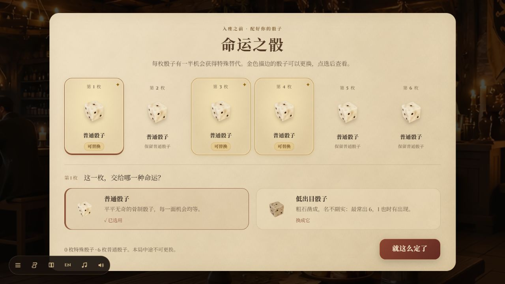
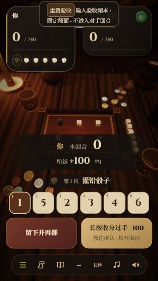

# v4.1 验证记录

日期：2026-11-03。基线：`1eb15cc`（v4.0）。

## 本次行为

- 命运之骰中，仅存在特殊替代的槽位显示金边、星纹和「可替换」标记；换好后显示「✓ 已选用」，当前查看的槽位另有棕红色底线。
- 回合选骰支持名称与缩略图提示，桌上骰子、下方按钮和数字键共用同一份选择信息。对手的骰子名称依旧保密。
- 收分必须持续按住 900 毫秒，鼠标/触控按钮、回车和聚焦收分按钮后的空格共用确认逻辑。普通点击不收分；松开、移出、失焦、切页、打开弹窗及更新选择会丢弃进度。

## 验证

- `node --test tools/test_ui_runtime.mjs`：12 项通过，新增覆盖长按阈值、提前释放、连续点击、指针取消/移出、页面隐藏、焦点变化、按钮销毁/禁用、按键重复和真实选择信息。
- `node tools/test_logic.mjs`：23 个计分用例通过，AI 统计检查正常完成。
- 单文件构建成功，约 21.21 MB；`git diff --check` 通过。
- 实际浏览器：正式首页完成推门到菜单并进入命运之骰，看到随机提供的槽位高亮，未记录 error/warn。
- 输入验收副本：实际选择灌铅骰子显示正确名称；250 毫秒鼠标按压/回车均未收分，1100 毫秒鼠标按压、从骰子按钮长按回车、聚焦收分按钮长按空格均正确收下 100 分，未重复收分。
- 320×568 手机视口检查中文和英文，页面宽度与滚动宽度均为 320，收分按钮无内部横向溢出。此项是浏览器尺寸模拟，并非实体触屏设备测试。

`tools/make_input_fixture.mjs` 生成忽略提交的 `.qa/input-review.html`：固定特殊骰子与骰面、让移动动画立即结束并暂停对手回合；选骰、收分控件和计分仍走正式代码。截图和结算验证中的固定骰面不作为随机对局证据。

## 截图

正式游戏的可替换高亮：

输入验收副本中的手机名称与长按按钮：

