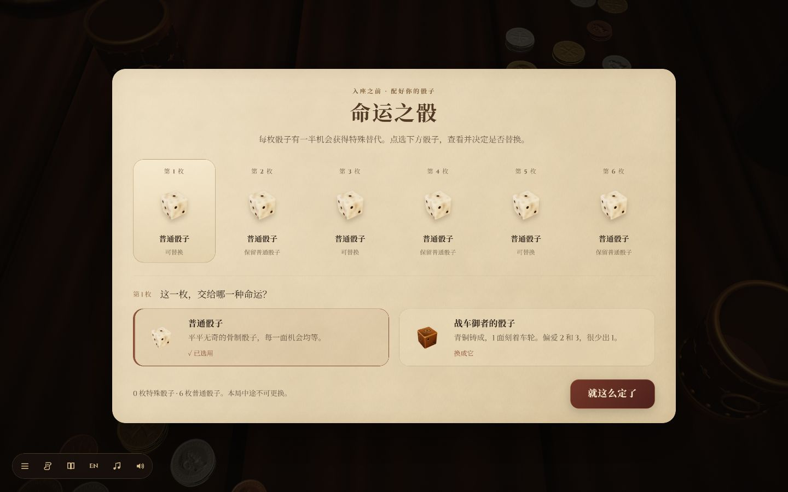
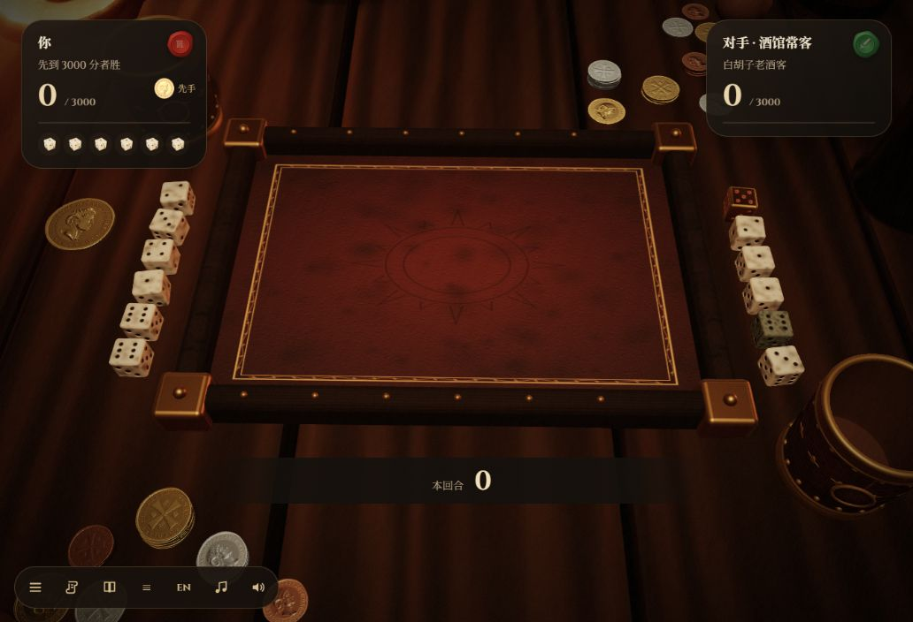
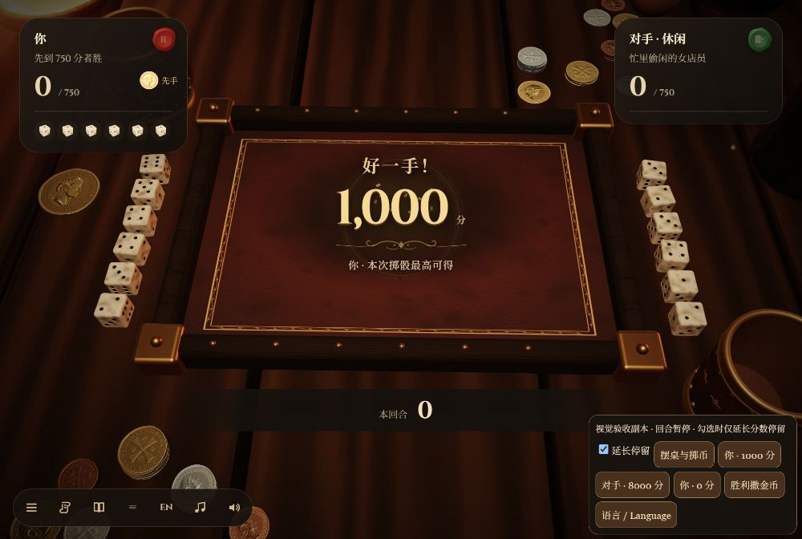
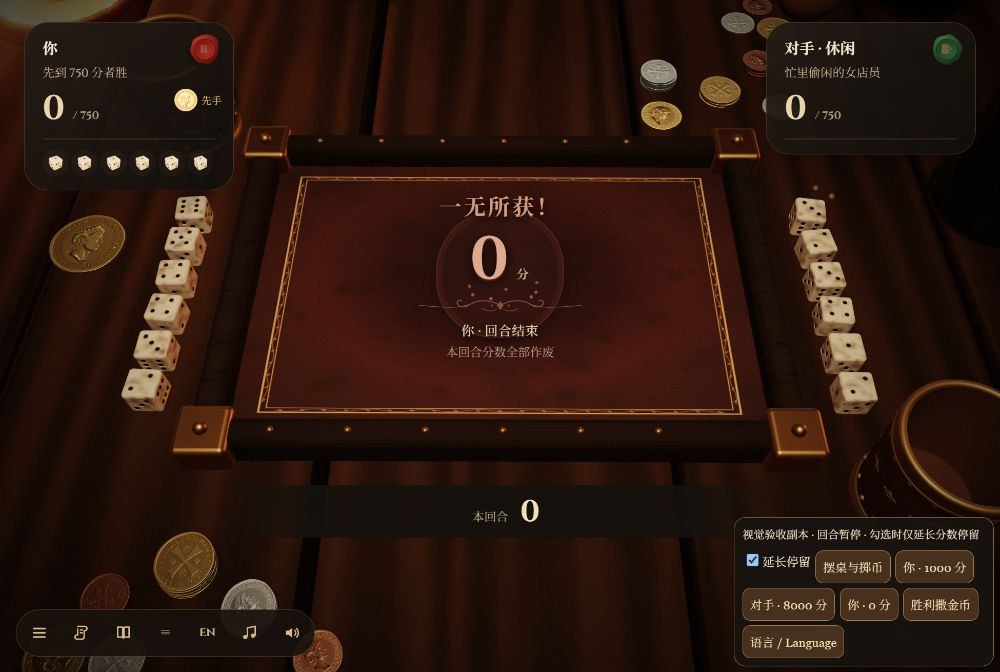
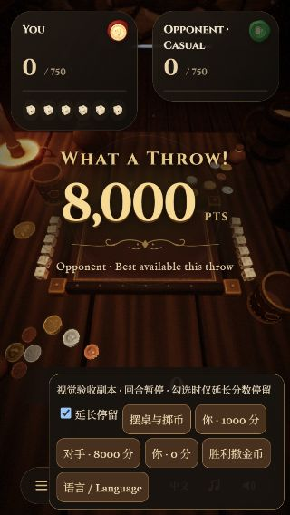
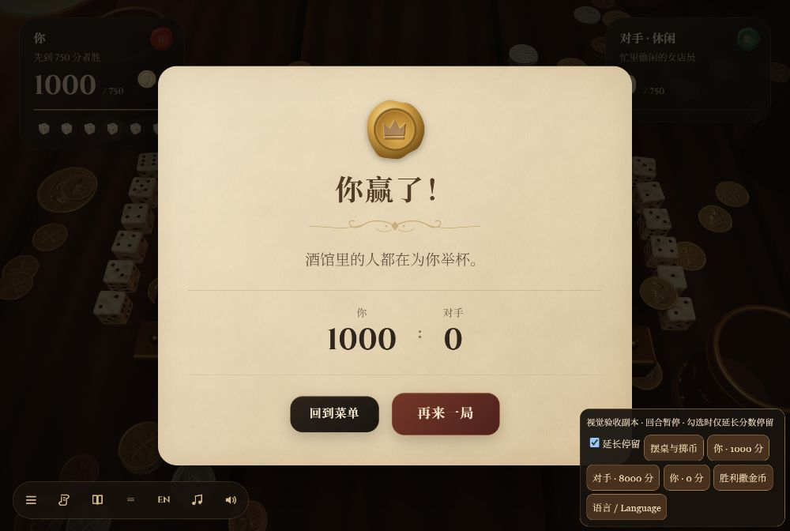

# v4.0 验证记录

日期：2026-11-03。基线：`a5489c2`（v3.4）。

## 视觉与交互

在 Windows 的内置 Chromium 浏览器中实际打开本地构建文件，使用页面控件操作；手机尺寸是浏览器视口模拟，并非实体手机测试。

| 范围 | 实测结果 |
| --- | --- |
| 桌面 1440×900 | 菜单露出对手与酒馆；选骰、计分牌、按钮、弹窗统一圆角；实际查看金、银、铜材质 |
| 竖屏 390×844、320×568 | 骰盘及两侧骰子完整可见；中文和英文选骰页可滚动；按钮没有横向溢出 |
| 横屏 844×390 | 工具栏与主操作分开，计分牌与操作按钮保持可见 |
| 掷币 | 正反两种结果均实际出现；只显示正反面与谁先手，等待玩家确认；金币改为普通银币直径的 1.8 倍，统一放在左侧中立位置 |
| 对局 | 实际掷骰、选择 1/5 组合并收下 150、200 分；完成一局休闲模式至结算（玩家 200，对手 1750），再来一局和返回菜单可用 |
| 中途取消 | 选骰时、摇骰时返回菜单后可重新开局；旧骰盅动画未干扰下一局 |
| 弹窗 | 计分规则可打开、关闭；空格关闭按钮没有同时触发底层掷骰；焦点恢复到工具栏 |
| 键盘与触屏 | 在已聚焦的骰子按钮上按 4、6，正确选中对应的两枚骰子并与第 1 枚组成三个 1（1000 分）；320 像素宽时六个主选骰按钮均为约 44×44 像素，无横向溢出 |
| 过场 | 完整推门开场到菜单、换对手、入座与返回菜单均运行；正常流程未记录到浏览器 error/warn |
| 解码失败 | `make_fault_fixture.mjs` 故意损坏开场视频；浏览器发出预期回退警告，仍能进入菜单、掷币及可操作的玩家回合 |

金币直径比首版 v4 方案缩小约 31%。收尾动作改为保持币面朝向，轻抬越过木框、平移、放下；落点与先手归属无关。中立落点与骰盘、待掷骰子、骰盅及钱堆分别留有空隙，竖屏下整个币缘仍处于画面内。

追加验收：硬币再次外移到 `x=-14.2, z=-1.8`，骰子与币缘之间留出明显空隙；窄屏视角为这枚币保留屏幕边距。实际检查了 1000×667、390×844、320×568 和 844×390 的画面。

分数与胜利效果使用 `node tools/make_animation_fixture.mjs` 生成的本地验收副本：它调用正式 UI 和撒币代码，暂停自动对局，允许延长提示停留以截图。已实际看到中文 0 / 1000 分、英文对手 8000 分，以及胜利金币落桌和结算。高分显示「本次掷骰最高可得」，0 分显示回合清零；修复了提示层因 `opacity:0` 而不可见的问题。浏览器确认提示透明度为 1、不接收点击、390 像素宽时无横向溢出；恢复正常时长后会淡出。此副本用于视觉检查，模拟胜利分数不算真实对局胜利测试。

## 自动检查

- `node --test tools/test_ui_runtime.mjs`：8 项通过，覆盖按键隔离、媒体事件/超时/播放失败、金币间距、窄屏投影、画质降级后缩放，以及双方 0 / 600 / 1000 / 2000 分的正式回合触发逻辑与计分不变。
- `node tools/test_logic.mjs`：23 个计分用例，0 失败；原有 AI 统计检查正常完成。
- `node tools/test_cup.mjs`：36/36 次成功，0 次骰子逃出骰盅，0 次大小恢复错误，全部放下盅盖。随机物理检查只代表本次样本。
- `node build.mjs`：单文件构建成功，约 21.20 MB，内嵌 47 段语音、37 张骰子缩略图和中文字体子集。
- `git diff --check`：通过。

上述检查不构成所有设备的帧率保证。物理规则、概率表及 AI 策略未改动。

## 实际截图

以下截图来自上述视觉验收副本，右下角面板仅用于本地验收。

