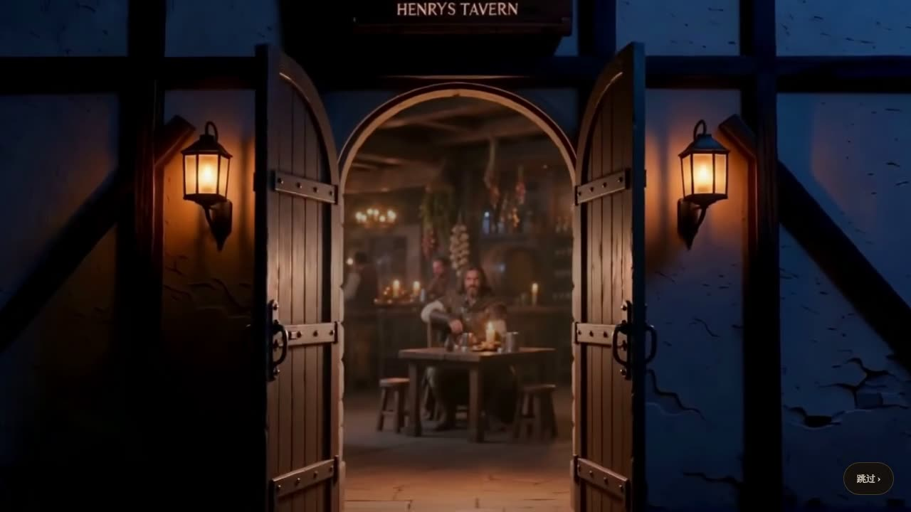
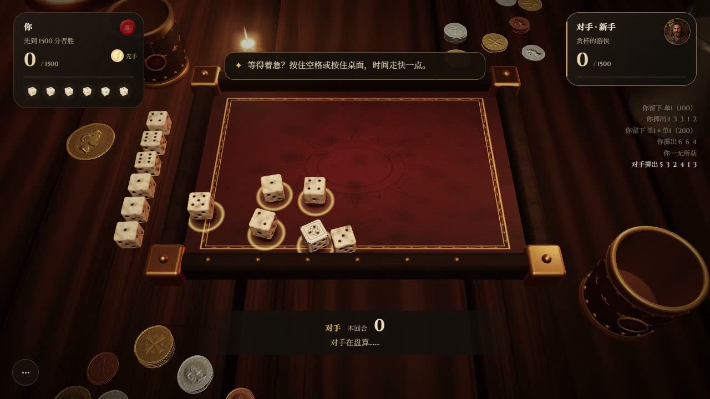
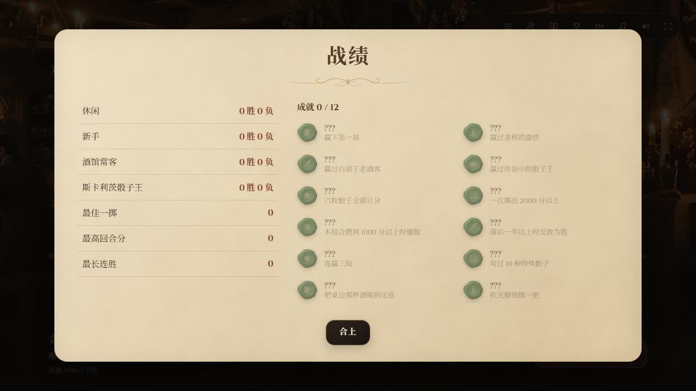

# v5.0 验证记录

日期：2026-11-05 至 11-06。基线：`5257b3e`（v4.1）。

## 本次行为

- 开场：换成 Seedance 2.0 生成的一镜到底（`finish_intro.py` 处理）。门外是深夜，门缝和两盏壁灯透一点光；门开到一半时门洞被压暗，壁灯亮度不受影响；完全走进酒馆后才升到平时的亮度。标题字幕挪到左下角，不再压在人物身上。
- 默认难度是新手，开场落到游侠对面。
- 四个对手的待机动画全部重做，每人加一段小动作（隔 6–13 秒插一段，等循环转回关键帧再接，没有重影）。老人的胸口起伏从 7 像素降到 2 像素以内，头和身体一起轻微晃动。
- 骰子和骰盅的物理、动作节奏都是 v4.1 的（重力 62、原来的摇盅和倒的时间）。第一版 v5 把重力提到 235、重写了路线，玩起来僵硬，已全部退回。只修穿模：摇盅和刚倒出来时物理步长从 1/240 秒细到 1/480 秒，盅壁半径 1.5 → 1.4，地板比皮面高 0.02。飞回骰盅时绕开盅身，跳到排上时先离开盘面再过去，举骰盅时一条弧线越过盘角。选中骰子时朝世界上方抬起（原来沿骰子自己的轴抬，v1.2 起就可能往旁边滑或陷进盘面）。
- 掷币：`coinPhysics.js` 把金币当薄圆片算（角动量守恒、边缘接触、摩擦），离线算好回放；圆片对称，回放时绕自身的轴转、翻面，要的那一面朝上、头像摆正，轨迹不变。
- 去掉：骰子点数分布图、爆骰风险百分比、钱袋、赌注、重抽、桌上的赌注堆和钱堆，以及慢镜头、镜头震动、鼠标视差、落地扬灰。骰子只有简单说明。

## 验证

- `node --test tools/test_ui_runtime.mjs`：13 项通过。
- `node tools/test_logic.mjs`：23 个计分用例通过。
- `node tools/test_cup.mjs`：36 次投掷没有骰子飞出骰盅。
- `node tools/test_clip.mjs`：全部通过。约 1.5 万帧里骰子互相陷进去最深 0.03（骰子边长 1）、穿出盅壁最深 0.015，陷进盘面、穿出盘边都是 0；v4.1 这几项是 0.13、0.27、0.1。骰子飞进骰盅 2 万个采样点、跳到排上 6 万个采样点没有碰到盅身和木框。掷币 30 次没有穿过皮面（最深 0.04，只有撞击那一帧）、没有飞出木框。胜利撒钱 420 枚没有穿过木框和实心物。
- 单文件构建成功，约 23.20 MB，过场动画 25 段。
- 开场片：Seedance 2.0 成片经 `finish_intro.py` 处理，最后一帧和待机片第一帧完全相同；游戏里实录，切到待机时前后帧变化不超过镜头正常移动，看不出接缝。整段亮度从 14 慢慢升到 45（满分 255），跨进门之前不超过 30。跳过开场能直接到选对手。
- 无头 Chrome 走完全流程：开场 → 选对手 → 换人 → 小动作 → 低头 → 对局 → 胜利 → 抬头回菜单，没有 error；片段顺序符合预期。
- 机器人打完整局，没有 error。彩蛋（蜡烛、喝酒、拨钱堆、henry）逐个点过，没有 error。
- 物理和动作是逐帧看录屏对过的，没有真人试玩数据。
- 选中骰子实测：世界坐标 x、z 偏移 0，y 抬起 0.4。
- 后台标签页：加载时切走 12 秒再切回，过场动画还在。
- 键盘：点数按钮上按空格是「留下并再掷」，不会取消骰子。
- H.264 备用片：在本地网站上让浏览器不认 AV1，开场和待机改放 `assets/cutscenes/h264/`（宽 960），没有 error。这是在桌面 Chrome 里模拟的，没有在真实 iPhone 上测过。
- 布局：1280×720、1440×810、390×844、844×390、320×568 的中文界面和 1440×810 的英文界面都截图看过。手机尺寸是浏览器模拟，不是实体设备。

## 截图

开门时门里保持昏暗：

走进酒馆后的标题：

对局选骰：

战绩和成就：

